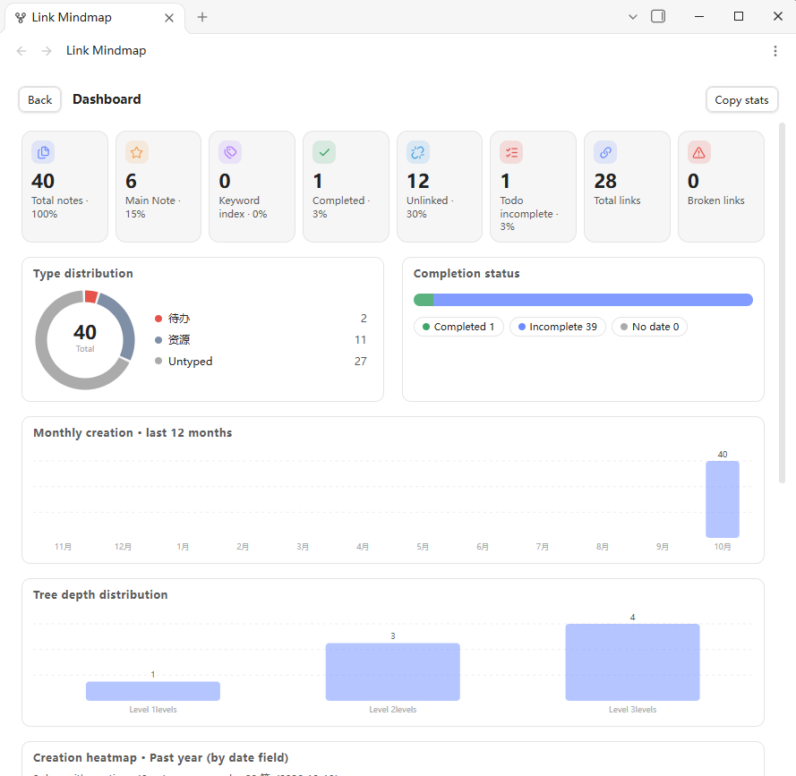
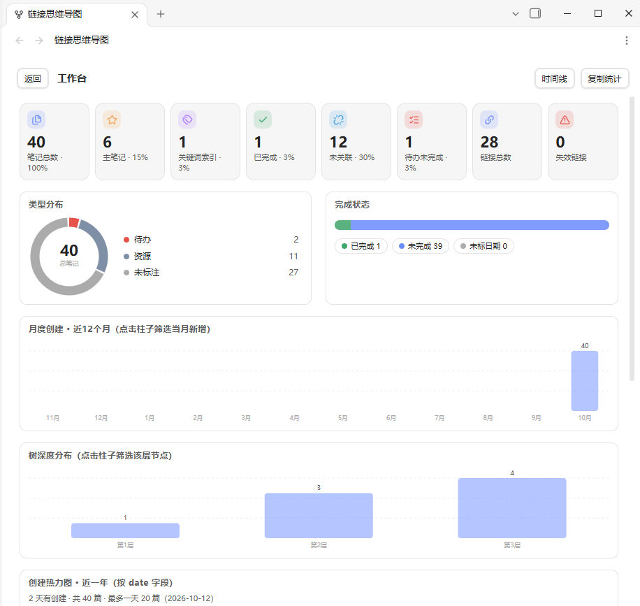

# Link Mindmap

A visual mindmap plugin for building and editing note relationships directly on the canvas. **Each node is a note** — create, connect, and reorganize your knowledge graph visually, without touching frontmatter by hand.




## Why This Plugin?

Obsidian's built-in **Graph View** shows your notes as a network, but you can't create or edit relationships from it — you have to manually edit wiki-links in each note. **Link Mindmap** fills that gap:

- **Visually create connections**: drag to reparent, drag from a node's port to draw a new link — the frontmatter `children`/`parent` fields are updated automatically
- **Build relationships on the canvas**: add child nodes, rename, reorder, move, delete — all without opening a single note file
- **Focus on one topic at a time**: start from any "main" note and explore its subtree as a clean hierarchical mindmap, instead of an overwhelming tangle of all notes
- **No numbering, no lock-in**: unlike traditional Zettelkasten with fixed IDs/numbers, notes are linked by `[[wikilinks]]` — rename freely, restructure instantly, no renumbering needed
- **Works with Graph View**: relationships built here are standard wiki-links, fully visible in Obsidian's native Graph View and Backlinks panel
- **Multi-select to curate**: pick any subset of notes (by type, status, or search) and display them together — then drag-connect them into a structure

## Core Concept

- **Node = Note file**: every node is a plain Markdown file in your vault
- **Edge = Wiki-link**: parent-child relationships are `[[wikilinks]]` in frontmatter, not external data
- **General-purpose**: works with any Markdown notes — no special syntax, no required templates
- **Inspired by Zettelkasten**: adopts Luhmann's hierarchical thinking and index notes, but removes the numbering constraint — you're free to restructure at any time

### Frontmatter Example

```yaml
---
children:
  - "[[Child Note A]]"
  - "[[Child Note B]]"
main: true
status: false
type: "todo"
date: "2026-10-11"
---
```

All field names are customizable in settings.

## Installation

### From Community Plugin Market

1. Go to **Settings → Community plugins → Browse**
2. Search for "Link Mindmap"
3. Click **Install**, then **Enable**

### Manual Installation

1. Download `main.js`, `manifest.json`, and `styles.css` from the [latest release](https://github.com/licfcn/link-mindmap/releases)
2. Create the folder `.obsidian/plugins/link-mindmap/` in your vault
3. Place the three files into that folder
4. Enable the plugin in **Settings → Community plugins**

## Quick Start

1. After enabling, configure the **Notes folder** in settings (default: `01-笔记`)
2. Click the **ribbon icon** or run command "Open Link Mindmap"
3. Right-click any node → **Add child** to create a new linked note
4. **Drag** a node onto another to reparent; **drag from the right port** to create a new association

## Features

### Mindmap View

- **Expand/collapse tree**: click the +/- button on each node or use toolbar
- **Pan & zoom**: drag to pan, scroll to zoom; pinch-to-zoom on mobile
- **Fit-to-window**: one-click auto-fit all nodes into view
- **Breadcrumb path navigation**: shows full path from root, click to jump
- **Multi-select mindmap**: pick any subset of notes (filter by type/status/search) and display them together on one canvas — then drag-connect to build relationships
- **Keyword index filtering**: use index notes to filter which notes appear
- **Search any note as root**: search and set any note as the mindmap root
- **Horizontal & vertical layouts**: switch between left-to-right and top-to-bottom
- **Export to SVG / PNG / Markdown outline**
- **Presets**: save and restore mindmap states (root, multi-select, depth, expand/collapse, zoom/pan) — switch between saved views with one click
- **Node content preview**: hover 1s to preview note content without opening the file
- **Search highlighting**: matched text highlighted in search results
- **Expand/collapse memory**: expansion state persisted across sessions
- **Selected node marker**: dashed border on user-selected root nodes in multi-select/keyword mode
- **Cross-level drag**: drag before/after a non-sibling node auto-reparents to target's parent
- **Sibling reorder**: drag to adjust order among siblings
- **Node filter**: toolbar filter input to highlight/hide matching nodes
- **Back history**: return to previous view position
- **Auto-locate**: opening a note auto-expands its branch and centers the node in the mindmap
- **Create standalone note**: create a new note not linked to any parent
- **Display toggles**: show/hide creation time, type, child count, open/add icons
- **Refresh**: re-read vault data after external changes

### Node Operations (right-click / long-press)

| Operation | Description |
|---|---|
| Add child | Create a new note and link it as a child (auto-selects template by type) |
| Focus | Set this node as the mindmap root |
| Rename | Rename file and auto-update all references |
| Move to parent | Move node under a different parent |
| Reorder siblings | Adjust order among siblings |
| Delete | Remove link or delete file (with subtree option) |
| Toggle status | Mark as done/todo |
| Modify type/date | Change type or date field |
| Open note | Open in new tab |
| Copy link / subtree outline | Copy `[[wikilink]]` or indented subtree |

### Drag & Drop

- **Drag node card**: move to a different parent
- **Drag from right port**: draw a new connection (multi-parent / network)

### Batch Mode

- Multi-select nodes with single click, select all / invert
- Bulk move, delete, modify type, toggle status

### Keyboard Shortcuts

| Key | Action |
|---|---|
| `↑` / `↓` | Navigate nodes |
| `←` / `→` | Collapse/expand · Go to parent/child |
| `Space` | Expand/collapse current |
| `Enter` | Open selected note |
| `Delete` | Delete selected node |
| `N` | Add child node |
| `B` | Go back |
| `/` | Search |
| `Esc` | Cancel selection / exit batch mode |

### Dashboard (Statistics Workbench)

A data dashboard with rich visualizations:

- **Statistics cards**: total notes, main notes, keyword indexes, completed, unlinked, broken links, total links, pending todos
- **Type distribution**: donut chart (click to filter)
- **Completion status**: stacked progress bar
- **Monthly creation**: bar chart for the past 12 months (click to filter)
- **Tree depth distribution**: node count per depth level (click to filter)
- **Creation heatmap**: GitHub-style yearly heatmap
- **Copy stats as Markdown**: export all statistics to clipboard

### Other

- **Timeline view**: browse notes by creation time with filtering (8 time ranges: all/today/week/month/year/past week/past month/past year) and sorting (date/name, asc/desc)
- **Normalize frontmatter**: batch or single-note command to sort and fill frontmatter fields per template
- **i18n**: auto-detect language, supports Chinese and English
- **Mobile support**: long-press menu, touch gestures, collapsible toolbar
- **Config export/import** (JSON backup)
- **Preset save location**: save presets in plugin data (default) or a vault file for cross-device sync
- **Performance**: incremental updates, viewport culling for large graphs

## Settings

| Category | Options |
|---|---|
| Paths | Notes folder, index folder, template path |
| Field names | All frontmatter fields customizable |
| Layout | Default depth, max name length, spacing, node height |
| Behavior | Auto-write backlinks, auto-locate current note |
| Display | Show time/type/child count/icons, curve connections |
| Colors | Primary, main note, duplicate, selected, completion |
| Types | Custom types with auto-assigned colors |
| Language | Auto / Chinese / English |

## Compatibility

- Minimum app version: 1.5.0
- Desktop and mobile (phone/tablet)
- No external services — fully local operation

## Feedback

- Report issues: [GitHub Issues](https://github.com/licfcn/link-mindmap/issues)

## License

[PolyForm Non-Commercial 1.0.0](LICENSE) — Free for personal and educational use. For commercial use, please contact the author.

---

# Link Mindmap（链接思维导图）

> 在画布上可视化地建立和编辑笔记间的关联。**一个节点就是一篇笔记**，拖拽即可创建父子关系，frontmatter 自动更新——无需手动编辑链接。




## 为什么需要这个插件？

Obsidian 自带的**关系图谱**能展示笔记间的网络，但你无法从中创建或编辑关联——只能回到每篇笔记里手动添加 `[[链接]]`。**链接思维导图**补上了这一环：

- **可视化创建关联**：拖动节点换父级，从节点右侧端口拖出连线建立新关联——frontmatter 的 `children`/`parent` 字段自动更新
- **在导图上完成一切**：新增子节点、重命名、排序、移动、删除——全程不用打开任何笔记文件
- **专注单一主题**：从任意「主笔记」出发，只看它的子树，而不是所有笔记混成一团
- **无编号、无锁定**：不像传统卢曼笔记靠固定编号建立顺序，这里靠 `[[双链]]` 关联——随时重命名、随时重构，无需重新编号
- **与关系图谱互通**：导图中建立的关联就是标准 wiki-link，在 Obsidian 原生关系图谱和反向链接面板中完全可见
- **多选筛选再关联**：按类型/状态/搜索筛选出一批笔记，显示在同一张导图上，然后拖拽连线建立结构

## 核心理念

- **节点 = 笔记文件**：每个节点是一篇普通的 Markdown 笔记，不是外部数据
- **关系 = frontmatter 双链**：父笔记的 `children` 字段存 `[[子笔记]]` 列表，顺序即兄弟顺序
- **通用性强**：适用于任何 Markdown 笔记，不需要特殊语法或模板
- **结合卢曼思想**：采纳层级笔记和索引笔记的理念，但去掉了编号限制——自由建立、随时改变
- **允许多父/网状**：一个笔记可被多个父笔记引用，形成网状知识图谱

### 笔记 frontmatter 示例

```yaml
---
children:
  - "[[子笔记A]]"
  - "[[子笔记B]]"
main: true
status: false
type: "待办"
date: "2026-10-11"
---
```

> 所有 frontmatter 字段名均可在设置中自定义。

## 安装

### 从社区插件市场安装

1. 设置 → 社区插件 → 浏览
2. 搜索「Link Mindmap」
3. 点击安装并启用

### 手动安装

1. 下载最新 [Release](https://github.com/licfcn/link-mindmap/releases) 中的 `main.js`、`manifest.json`、`styles.css`
2. 在 vault 中创建 `.obsidian/plugins/link-mindmap/` 目录
3. 将三个文件放入该目录
4. 设置 → 社区插件 → 启用「Link Mindmap」

## 快速开始

1. 启用插件后，在设置中配置「笔记文件夹」（默认 `01-笔记`）
2. 点击功能区图标或命令面板「打开链接思维导图」
3. 右键任意节点 →「新增子节点」创建关联笔记
4. **拖动**节点到另一个节点上换父级；从**右侧端口**拖出连线建立新关联

## 功能清单

### 导图视图

| 功能 | 说明 |
|---|---|
| 展开/折叠 | 点击节点右侧按钮或菜单操作 |
| 全展/全折 | 工具栏一键展开或折叠所有节点 |
| 平移缩放 | 鼠标拖动平移、滚轮缩放；手机端双指缩放 |
| 面包屑路径 | 显示根节点到当前的完整路径，可点击跳转 |
| 多选导图 | 按类型/状态/搜索筛选多篇笔记同时显示在一张导图上，再拖拽连线建立关联 |
| 关键词索引 | 按关键词索引文件过滤显示导图 |
| 搜索 | 搜索任意笔记作为导图根节点 |
| 适应窗口 | 一键缩放至完整显示所有节点 |
| 横纵布局 | 横向（左→右）或纵向（上→下）布局切换 |
| 导出 | 导图为 SVG / PNG / Markdown 大纲 |
| 预设 | 保存/恢复多个导图状态（根节点、多选、深度、折叠、缩放平移），一键切换 |
| 节点预览 | 悬停 1 秒显示节点内容预览，无需打开文件 |
| 搜索高亮 | 搜索时匹配文本高亮显示 |
| 折叠记忆 | 展开/折叠状态跨会话保持 |
| 选中标记 | 多选/关键词模式下选中节点虚线边框标记 |
| 跨层级拖拽 | 拖到非兄弟节点 before/after 自动 reparent 到目标父节点下 |
| 同级排序 | 拖拽调整同级节点顺序 |
| 节点筛选 | 工具栏筛选输入框，按文本筛选节点 |
| 返回历史 | 返回上一次视图位置 |
| 自动定位 | 打开笔记时导图自动展开分支并居中该节点 |
| 创建独立笔记 | 工具栏新增按钮，创建不关联任何父节点的笔记 |
| 显示切换 | 显示/隐藏创建时间、类型、子数、打开/新增图标 |
| 刷新 | 重新读取 vault 数据（外部修改后） |

### 节点操作（右键/长按菜单）

| 操作 | 说明 |
|---|---|
| 打开笔记 | 在新标签页打开文件 |
| 新增子节点 | 创建子笔记并自动写入 children 链接，按类型自动选择模板 |
| 聚焦到此节点 | 将该节点设为导图根节点 |
| 跳到上级 | 跳转到父笔记（多父时列出所有上级） |
| 标记完成/取消 | 切换 status 字段 |
| 修改类型/日期 | 弹出选择框修改对应字段 |
| 重命名 | 重命名文件并同步更新所有引用 |
| 复制链接 | 复制 `[[笔记名]]` 到剪贴板 |
| 复制子树大纲 | 复制整棵子树为缩进列表 |
| 移动到父卡 | 移动到指定父笔记下 |
| 同级排序 | 在同级节点中调整顺序 |
| 删除节点 | 移除关联/删除文件（含子节点选择） |

### 拖拽操作

| 操作 | 说明 |
|---|---|
| 拖动节点卡片 | 移动节点到其他父笔记下 |
| 拖动右侧端口 | 连线建立额外关联（多父/网状） |

### 批量模式

- 单击选中多个节点，全选/反选
- 批量移动、删除、修改类型、标记完成

### 快捷键

| 键 | 功能 |
|---|---|
| `↑` / `↓` | 上/下导航节点 |
| `←` / `→` | 左：折叠/到父节点 · 右：展开/到子节点 |
| `Space` | 展开/折叠当前节点 |
| `Enter` | 打开选中节点笔记 |
| `Delete` | 删除选中节点 |
| `N` | 新增子节点 |
| `B` | 返回上一次视图 |
| `/` | 唤起搜索 |
| `Esc` | 取消选中 / 退出批量模式 |

### 工作台（统计仪表盘）

一键切换的数据仪表盘，聚合展示知识库全貌：

| 统计维度 | 说明 |
|---|---|
| 统计卡片 | 笔记总数/主笔记/关键词索引/已完成/未关联/失效链接/链接总数/待办未完成，含百分比 |
| 类型分布 | 环形图 + 图例（可点击筛选） |
| 完成状态 | 堆叠进度条（已完成/未完成/未标日期） |
| 月度创建 | 近12个月柱状图（点击柱子筛选当月新增） |
| 树深度分布 | 各层节点数横向柱状图（点击筛选该层节点） |
| 创建热力图 | GitHub 风格年度热力图，含统计摘要 |
| 复制统计 | 一键复制所有统计为 Markdown |

### 其他功能

- **时间线视图**：按文件创建时间浏览笔记，支持八档时间筛选（全部/今日/本周/本月/本年/近一周/近一月/近一年）和排序（日期/名称、新→旧/旧→新）
- **整理笔记属性**：批量或单篇按模板整理 frontmatter 字段顺序并补充缺失字段
- **中英文切换**：自动检测语言，支持中文/英文切换（设置中切换）
- **导出/导入配置**：JSON 格式备份和恢复所有设置
- **导图预设**：保存多个导图状态预设，一键恢复；保存位置可配置为插件数据或 vault 文件（支持跨设备同步）
- **性能优化**：文本宽度缓存、增量更新、视口裁剪（>500 节点）

## 设置项

| 分类 | 选项 |
|---|---|
| 路径配置 | 笔记文件夹、索引文件夹、模板路径 |
| 字段名配置 | 所有 frontmatter 字段名可自定义 |
| 布局配置 | 默认层数、名称字数、间距、节点高度 |
| 行为配置 | 写入反向链接、自动定位当前笔记 |
| 显示配置 | 显示时间/类型/子数/图标、曲线连接 |
| 颜色配置 | 主色/主笔记/重复/选中/完成色 |
| 类型配置 | 自定义类型，自动分配颜色，排序/删除 |
| 语言配置 | 自动 / 中文 / English |

## 手机端适配

- 长按 500ms 弹出菜单（替代右键）
- 双指缩放、单指拖放
- 增大点击区域（≥ 36px）
- 工具栏可折叠

## 技术细节

- 插件 ID：`link-mindmap`
- CSS 前缀：`lkm-`
- 视图类型：`link-mindmap-view`
- 最低版本：1.5.0
- 功能区图标：`git-merge`（Lucide）
