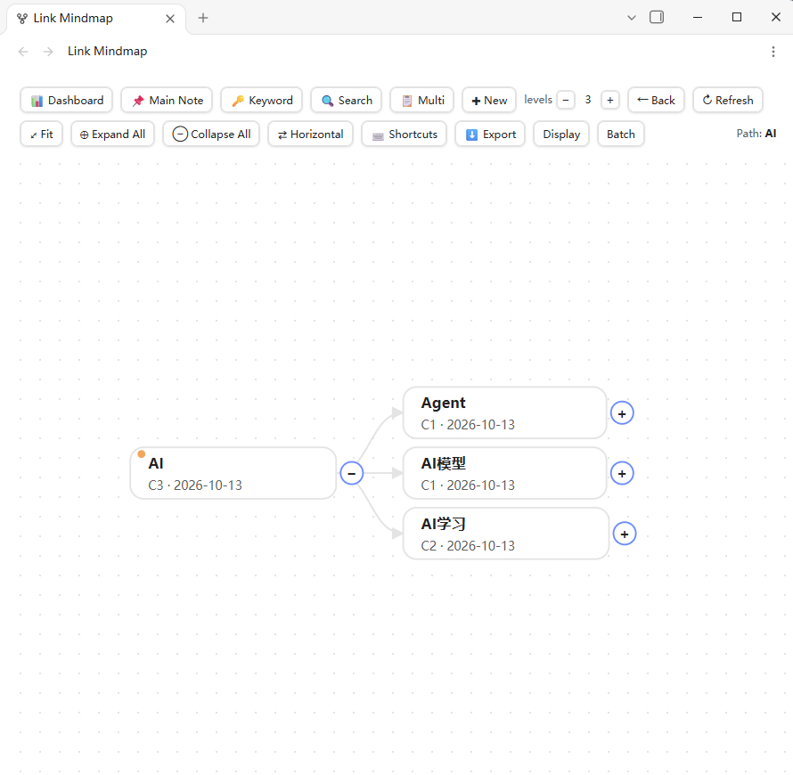
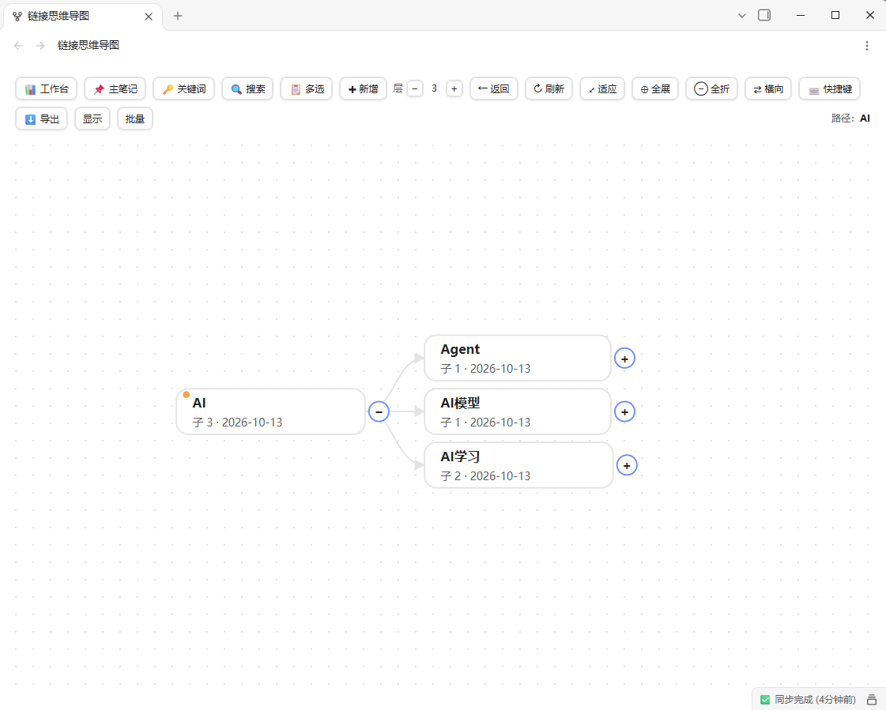

# Link Mindmap

> [中文文档](#link-mindmap链接思维导图) · [English](#link-mindmap)

A visual mindmap plugin for Obsidian — **each node is a note**, drag to build relationships, frontmatter auto-updates.

## Features

- **Visual relationships**: drag to reparent, drag from port to connect — `children`/`parent` frontmatter auto-updated
- **Node = Note**: Markdown files linked by `[[wikilinks]]`, no lock-in, rename freely
- **Mindmap view**: expand/collapse, pan/zoom, fit, breadcrumbs, horizontal/vertical layout, presets, hover preview
- **5 layout modes**: Tree / Branch / Git branch (swim-lane + jumps + time axis) / Link (flowchart + sibling chain) / Network (force-directed, drag to reposition)
- **Multi-select**: filter by type/status/search, display together, drag-connect
- **Node ops**: add child, rename, move, reorder, delete, change status/type/date — via right-click menu
- **Batch**: multi-select, bulk move/delete/modify
- **Dashboard**: stats cards, type/status distribution, monthly bars, depth chart, heatmap
- **Timeline**: browse by creation time, filter/sort
- **Export**: SVG / PNG / Markdown outline / Obsidian Canvas
- **Excalidraw support**: create/convert `.excalidraw.md` notes, preview as embed
- **Description field**: per-note description shown under title (auto-height or truncated)
- **Commands**: normalize frontmatter, clean invalid types/statuses, check links, convert to excalidraw
- **i18n**: Chinese/English, auto-detect
- **Mobile**: long-press menu, touch gestures

## Installation

1. Settings → Community plugins → Browse → search "Link Mindmap"
2. Or manual: download `main.js`/`manifest.json`/`styles.css` into `.obsidian/plugins/link-mindmap/`

## Quick Start

1. Configure notes folder (default `01-笔记`)
2. Ribbon icon or command "Open Link Mindmap"
3. Right-click node → Add child; drag node to reparent; drag port to connect

---

# Link Mindmap（链接思维导图）

> [English](#link-mindmap) · [中文文档](#link-mindmap链接思维导图)

在画布上可视化建立笔记关联——**一个节点就是一篇笔记**，拖拽即建关系，frontmatter 自动更新。

## 功能

- **可视化关联**：拖动换父级，从端口拖出连线——`children`/`parent` 自动更新
- **节点即笔记**：Markdown 文件靠 `[[双链]]` 关联，无锁定，随时重命名
- **导图视图**：展开/折叠、平移缩放、适应、面包屑、横纵布局、预设、悬停预览
- **5 种导图模式**：树形图 / 分叉图 / 分支图（泳道+跳线+时间轴） / 链路图（流程图+兄弟串联） / 网络图（力导向布局，可拖拽节点）
- **多选导图**：按类型/状态/搜索筛选，同屏显示，拖拽连线
- **节点操作**：新增子节点、重命名、移动、排序、删除、改状态/类型/日期——右键菜单
- **批量模式**：多选，批量移动/删除/修改
- **工作台**：统计卡片、类型/状态分布、月度柱状图、深度图、热力图
- **时间线**：按创建时间浏览，筛选/排序
- **导出**：SVG / PNG / Markdown 大纲 / Obsidian Canvas
- **Excalidraw 支持**：新建/转换 `.excalidraw.md` 笔记，嵌入预览
- **描述字段**：每笔记 description 显示在标题下（自适应高度或截断）
- **命令**：整理属性、清除失效类型/状态、检查链接、转为 excalidraw
- **中英文**：自动检测，支持切换
- **手机端**：长按菜单、触控手势

## 安装

1. 设置 → 社区插件 → 搜索「Link Mindmap」
2. 或手动：下载 `main.js`/`manifest.json`/`styles.css` 到 `.obsidian/plugins/link-mindmap/`

## 快速开始

1. 配置笔记文件夹（默认 `01-笔记`）
2. 功能区图标或命令「打开链接思维导图」
3. 右键节点→新增子节点；拖动节点换父级；拖端口连线

## 设置

语言、笔记/索引/模板文件夹、字段名、布局（节点高度 0=自适应）、显示开关、颜色、类型/状态、预设、配置导入导出。

## 兼容性

最低 Obsidian 1.5.0，桌面/手机，纯本地。

## 反馈

[GitHub Issues](https://github.com/licfcn/link-mindmap/issues)

## License

PolyForm Non-Commercial 1.0.0
